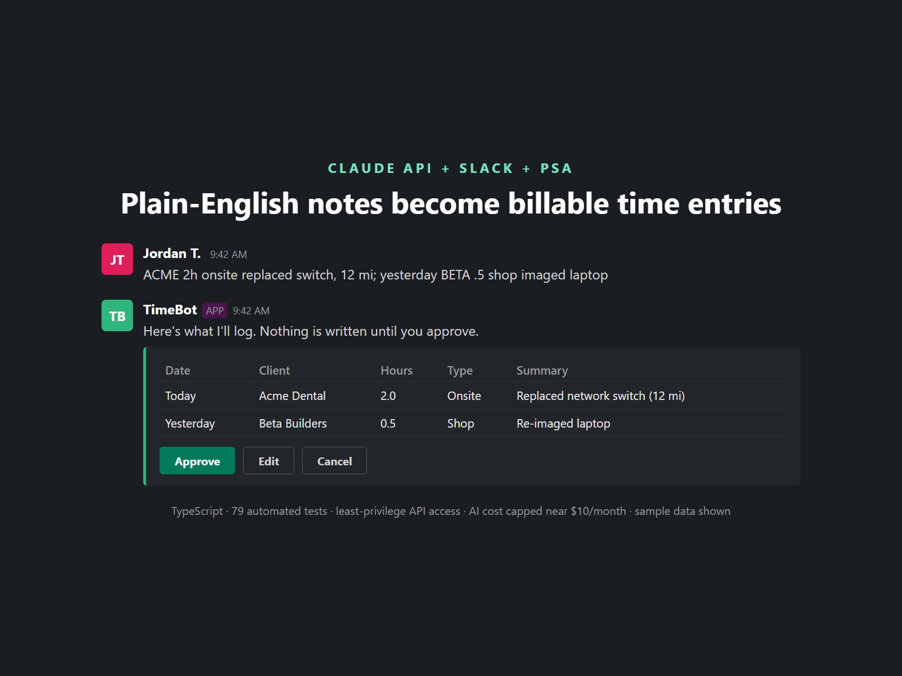
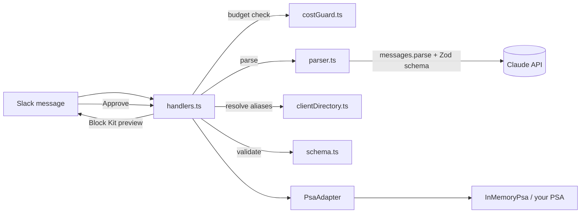

# Slack Time Entry Bot

Technicians post plain-English notes in Slack. The bot uses Claude to turn them into structured time entries, shows a preview, and saves them to your PSA only after the technician clicks **Approve**.



> The screenshot and the sample client list use made-up data.

```
Jordan: ACME 2h onsite replaced switch, 12 mi; yesterday BB .5 shop imaged laptop

Bot:    Here's what I'll log. Nothing is saved until you approve.
        Acme Dental   - 2026-10-28 - 2h onsite, 12 mi - Replaced network switch
        Beta Builders - 2026-10-27 - 0.5h shop        - Re-imaged laptop
        [Approve] [Cancel]
```

## Why it exists

Technicians hate filling in time entries, so time gets logged late, vaguely, or not at all, and that is billable time a managed IT business never invoices. Typing one sentence into Slack is easy. This bot does the rest without letting a model write to the billing system unsupervised.

## How it stays safe

| Risk | What the bot does |
|---|---|
| The model invents or misreads work | Claude only proposes entries. A human approves every batch, and only the person who posted the note can approve it. |
| Malformed output | [Structured outputs](https://platform.claude.com/docs/en/build-with-claude/structured-outputs) with a Zod schema guarantee the response shape. |
| Plausible but wrong values | Business rules run in code, not in the prompt: quarter-hour increments, 0.25-16h per entry, no future dates, sane mileage. |
| A hallucinated client | Client shorthand ("ACME", "BB") is resolved against your client list in code. Unknown names are rejected and explained, never guessed. |
| A surprise API bill | A hard monthly budget is checked before every call and recorded after it. At the cap, the bot stops calling the model. |
| Refusals and truncation | `stop_reason` is checked before any output is used. |
| Double billing | Each preview can be approved once, and previews expire after an hour. |

## Architecture



| File | Responsibility |
|---|---|
| `src/parser.ts` | Prompt and the Claude call (`messages.parse` with `zodOutputFormat`, low effort) |
| `src/schema.ts` | Entry schema and business-rule validation |
| `src/clientDirectory.ts` | Maps technician shorthand to real client records |
| `src/costGuard.ts` | Per-model pricing and the monthly spend cap |
| `src/slack/handlers.ts` | Note, approve, and cancel logic (framework-free, fully tested) |
| `src/slack/app.ts` | Thin Slack Bolt wiring (Socket Mode) |
| `src/psa/` | `PsaAdapter` interface and an in-memory implementation |

## Run it

Requires Node 20+, a Slack workspace where you can install apps, and an Anthropic API key.

```bash
npm install
cp .env.example .env    # fill in the values
npm run dev
```

Slack app setup: create an app, enable **Socket Mode** (this gives you the `xapp-` token), add the bot scopes `chat:write`, `channels:history`, and `im:history`, subscribe to the `message.channels` and `message.im` events, enable **Interactivity**, then install the app to get the `xoxb-` token.

### Choosing a model

`CLAUDE_MODEL` defaults to `claude-opus-5-5`. Reading a short note is an easy task, so `claude-haiku-5-5` is a reasonable choice if cost matters more than edge cases; prices for both live in `src/costGuard.ts`, and the bot refuses to start with a model that has no price, so the cap always works.

## Tests

```bash
npm test          # 36 tests, no network calls
npm run typecheck
```

The Claude client is replaced by a fake in tests, so the suite runs offline and costs nothing. CI also runs [gitleaks](https://github.com/gitleaks/gitleaks) on every push.

## Connecting a real PSA

Implement `PsaAdapter` (`src/psa/types.ts`) for your system, for example Autotask, ConnectWise, or HaloPSA, and pass it in `src/index.ts` instead of `InMemoryPsa`. Use an API account limited to creating time entries.

## How this was built

I built this with Claude Code, Anthropic's AI coding assistant, the same way I build automations for clients: I set the design, the safety rules, and the test cases, the assistant drafted code against them, and nothing went in without passing the test suite and my review. I'm responsible for every line.

It is a clean-room version of a time-entry bot I built for a managed IT company. No code, client names, or data from that project are included.

## License

MIT
